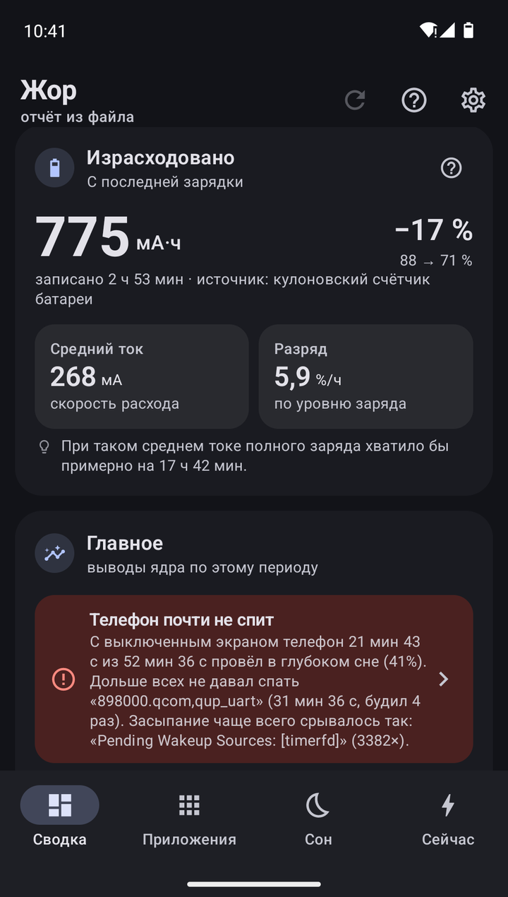
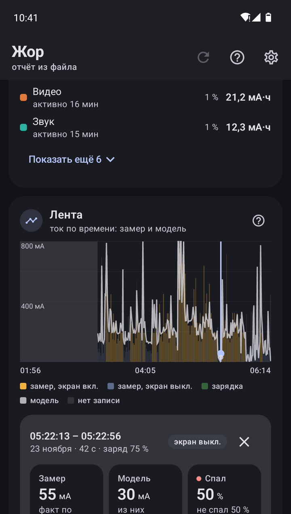
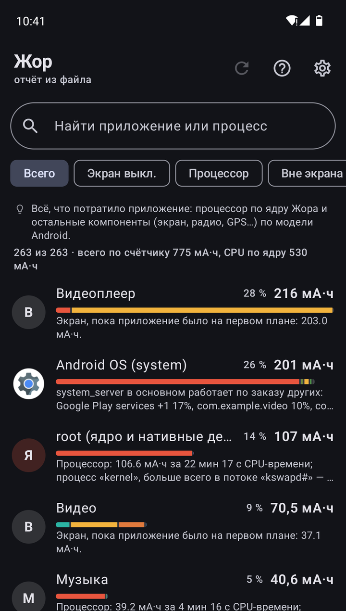
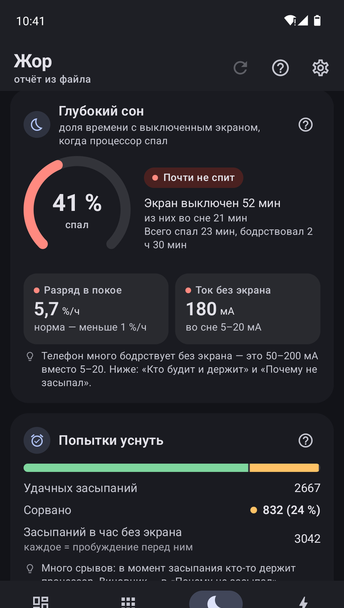
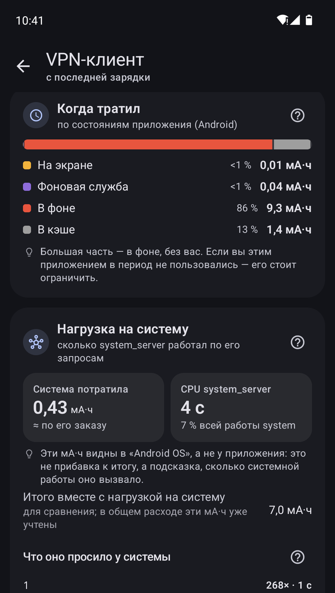
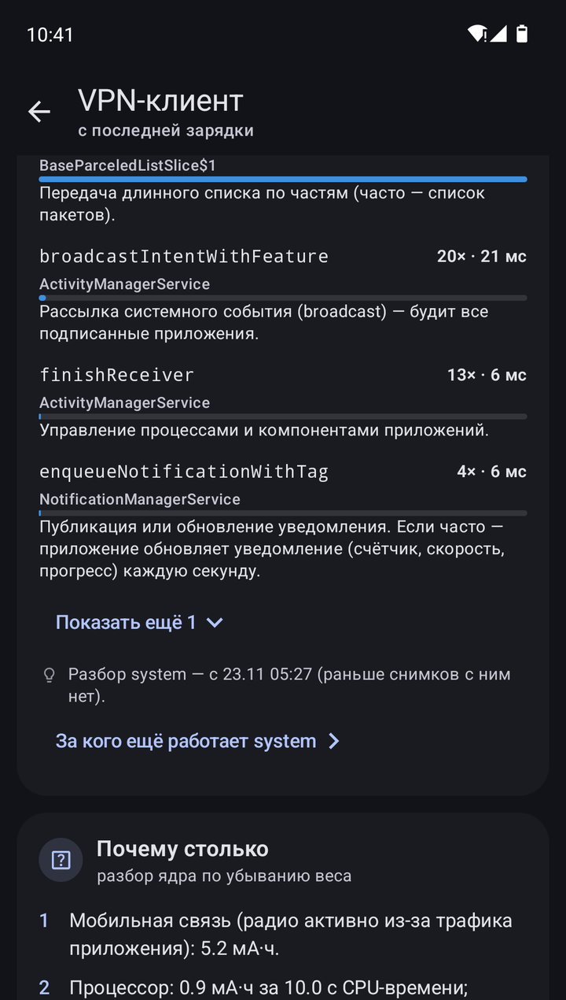
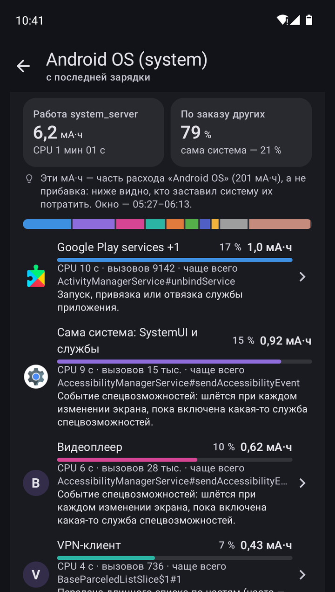
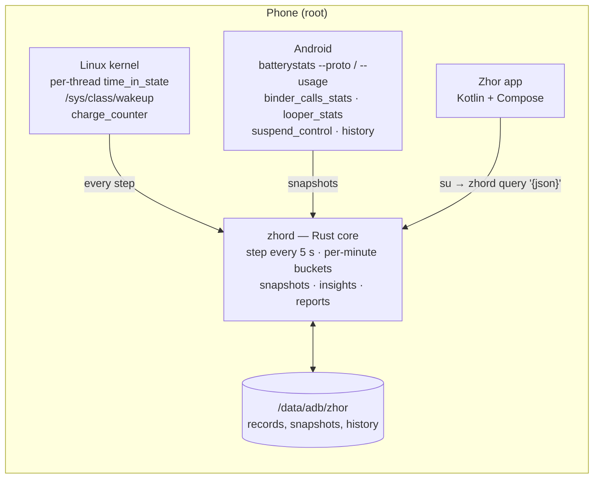

<div align="center">


# Zhor

**What is eating your Android battery — down to the process, the thread and the reason.**

A root energy profiler. A Rust core measures every thread at every CPU frequency, checks the model
against the battery's coulomb counter and explains who, where, how much and why.

[](https://github.com/niazlv/zhor/releases/latest)
[](https://github.com/niazlv/zhor/actions/workflows/ci.yml)
[](LICENSE)


**[Download APK](https://github.com/niazlv/zhor/releases/latest)** · [Русский](README.md) · [Core API](docs/api.md) · [How it works](#how-it-works) · [Changelog](CHANGELOG.md)

</div>

> *Zhor* (жор) is Russian slang for a ravenous appetite — as in "what's got such an appetite for my battery?".
> The app's interface and explanations are in Russian for now; the CLI report, the JSON API and this
> README are usable without it.

<table>
  <tr>
    <td align="center"><br><sub><b>Summary</b> — measured, modelled, insights</sub></td>
    <td align="center"><br><sub><b>Timeline</b> — tap any minute</sub></td>
    <td align="center"><br><sub><b>Who drains</b> — with breakdown</sub></td>
    <td align="center"><br><sub><b>Sleep</b> — who wakes and holds</sub></td>
  </tr>
  <tr>
    <td align="center"><br><sub><b>App</b> — when and on what</sub></td>
    <td align="center"><br><sub><b>Why so much</b></sub></td>
    <td align="center"><br><sub><b>Who makes system work</b></sub></td>
    <td align="center" valign="middle"><sub>Screenshots use anonymised<br>demo data: every third-party<br>app is replaced with<br><code>com.example.*</code></sub></td>
  </tr>
</table>

## Why

The stock battery screen says "app X — 12 %" and stops there. The old root profilers — BetterBatteryStats,
Wakelock Detector, GSam Root Companion — went much further, but broke on Android 12 and later:
`/proc/wakelocks` is long gone, `debugfs` is locked down, `/proc/uid_time_in_state` gave way to eBPF, and
the internal `BatteryStatsImpl` format changes from release to release.

Zhor is rebuilt on what modern kernels and Android actually provide, and answers four questions:

| | |
|---|---|
| **Who** | the app and its processes — WebView renderers and isolated sandboxes are attributed to the host app |
| **Where** | the exact thread: `RenderThread`, `binder`, a `kworker/…` queue, `kswapd`, `HeapTaskDaemon` — with a note on what it does |
| **How much** | mAh by model (thread time at each frequency × core current) and the real drain from the battery's coulomb counter |
| **Why** | wakelocks, alarms, jobs, syncs, GPS, radio, sensors, kernel wakeups, aborted suspends — and who keeps `system_server` busy |

## Features

- **CPU down to the thread.** The Linux kernel tracks, for every thread, the time spent at each frequency
  of each cluster (`/proc/<pid>/task/<tid>/time_in_state`). Zhor multiplies it by the core current at that
  frequency from the vendor power profile and gets mAh per thread — no tracing, nothing missed.
- **Measured vs. modelled.** How much actually left the battery (coulomb counter) and how much the CPU and
  screen model explains. The rest — radio, Wi-Fi, GPS, GPU, peripherals — is shown honestly as its own line.
- **Sleep.** Deep-sleep share with the screen off, successful and aborted suspends, kernel wakeup sources
  (`/sys/class/wakeup`), wakeup reasons and native wakelocks of services and HALs, with PIDs.
- **Who makes system work.** "Android OS" almost always works on someone's behalf. Android's sampled
  `binder_calls_stats` and `looper_stats` show which app cost `system_server` how much CPU, and through which
  call — an account poll in a loop, or a notification updated every second.
- **Insights.** "The phone barely sleeps", "Loads the system: …", "Low on memory", "Keeps restarting" —
  graded good / so-so / bad, with a hint on what to do.
- **Timeline.** Current over time: measured and modelled, screen, charging. Tap any minute to see who was
  draining right then; a range opens as a full report.
- **Android history.** batterystats events (wakelocks, jobs, syncs, screen, doze) to the millisecond —
  as a per-app timeline.
- **Watchdog.** A notification while the problem is happening, not the next morning: the phone does not sleep,
  the battery melts while idle, something wakes the CPU thousands of times an hour, an app keeps working in the
  background, the phone heats up in a pocket. Thresholds are adjustable, noise can be muted. Checks run on the
  core's regular step and never wake the phone.
- **Before and after.** Restrict an app's background work or stop it right from its card, then compare idle time
  before and after: current, drain, sleep, wakeups, the app's CPU, alarms and wakelocks. Or just last night vs. tonight.
- **Now.** Live battery current and who is burning CPU right now.
- **Your data, at hand.** Storage used and record count per day; export the report as JSON, text or raw
  `.jsonl.gz` records in two taps.

## How it works



- **The `zhord` core** is a root daemon written in Rust (`core/`). Every 5 s with the screen on, and every
  20 s of awake time with the screen off, it reads processes, threads, frequencies, battery, screen and wakeup
  sources, folds them into per-minute buckets and keeps 10 days. Android statistics snapshots are taken
  hourly, on screen and charger changes, and on demand.
- **The app** (`android/`) is a thin UI: a single root shell, `zhord query '<json>'` requests, JSON
  responses. The contract is documented in [`docs/api.md`](docs/api.md) (in Russian).
- **The model:** thread energy = Σ (time at frequency × core current at that frequency) from
  `dumpsys batterystats --power-profile`; screen by brightness; the ground truth is the coulomb counter.

## Requirements

- Android 12 or newer, arm64. Tested on a Xiaomi 15 Ultra (Android 17, GKI kernel 6.6).
- Root: KernelSU or Magisk (`su` is required; start on boot uses `/data/adb/service.d`).
- A kernel with `CONFIG_CPU_FREQ_TIMES` (present in nearly every Android kernel) for per-frequency accuracy.
  Without it Zhor still works, but estimates thread energy from the cluster's average current.

## Install

1. Download `zhor-*.apk` from the [latest release](https://github.com/niazlv/zhor/releases/latest) and install it.
2. Open Zhor and grant it root in KernelSU or Magisk. It copies the core to `/data/adb/zhor/bin/zhord` and
   starts it; on updates it replaces the core only if the bundled build is newer.
3. Start on boot is a toggle in the app's settings.

Every release is built by [GitHub Actions](https://github.com/niazlv/zhor/actions/workflows/release.yml)
from its tag and ships with `SHA256SUMS` and a build provenance attestation. APK signing certificate, SHA-256:

```text
D6:8C:8C:CD:B4:00:27:77:FF:2C:78:91:30:52:4C:05:9D:7B:2E:B4:F2:A6:1D:D5:A1:9D:10:79:EA:CF:46:1C
```

### Build from source

You need [Rust](https://rustup.rs) with the `aarch64-linux-android` target,
[`cargo-ndk`](https://github.com/bbqsrc/cargo-ndk), Android SDK 36 with NDK 27, and JDK 17–21.

```bash
rustup target add aarch64-linux-android
cargo install cargo-ndk
```

```bash
./build.sh            # core tests, arm64 core, APK
```

```bash
./build.sh install    # same + install on the connected phone (adb)
```

The NDK is taken from `ANDROID_NDK_HOME` (defaults to the Android Studio path on macOS), the JDK from
`JAVA_HOME`. With several devices attached, pick one with `ANDROID_SERIAL`.

A local build is signed with your debug key and won't install over a GitHub release — uninstall the app
first (the core's data in `/data/adb/zhor` stays). To use your own key, put `storeFile`, `storePassword`,
`keyAlias` and `keyPassword` into `~/.android/zhor-release.properties`.

### Releasing

Bump the version in `core/Cargo.toml` and `android/app/build.gradle.kts` (`versionName` and `versionCode`),
add a section to [`CHANGELOG.md`](CHANGELOG.md) and push a tag — [`release.yml`](.github/workflows/release.yml)
does the rest:

```bash
git tag v0.5.1 && git push origin v0.5.1
```

## Command line

The core works without the app too — for example over adb:

```bash
adb shell su -c '/data/adb/zhor/bin/zhord report'               # since unplug
adb shell su -c '/data/adb/zhor/bin/zhord report screen_off'    # the last screen-off period
adb shell su -c '/data/adb/zhor/bin/zhord report 24h --json'    # what the app sees
adb shell su -c '/data/adb/zhor/bin/zhord oneshot 10'           # no daemon: who is draining right now
adb shell su -c '/data/adb/zhor/bin/zhord alerts'               # what the watchdog noticed
adb shell su -c '/data/adb/zhor/bin/zhord compare rest'         # the last two idle periods
```

Presets: `since_unplug`, `screen_off`, `charge`, `1h` `3h` `6h` `12h` `24h` `48h`, `all`;
plus `live`, `status`, `stop` and `query '<json>'` — see [`docs/api.md`](docs/api.md).

## What Zhor itself costs

A profiler that drains the battery is useless, so Zhor bills itself like everyone else: the `zhord` process
shows up in the report, and the app has a "cost of Zhor itself" card.

- **Doesn't block sleep.** The core takes no wakelocks and sets no alarms or wake timers; steps run on a
  monotonic timer that stops during suspend. A step happens only while the phone is awake anyway.
- **A step is ≈ 30 ms of CPU.** Idle processes are read every 6th step and threads are broken down every
  ~30 s per process — totals stay exact, only the detail lags.
- **About 2 mA with the screen on** (~0.3–0.4 % of the drain), zero in deep sleep.
- **An Android statistics snapshot is ≈ 0.5 s of `system_server` CPU**, hourly and on screen or charger
  changes. The summary comes from `--proto` (~100 ms instead of ~450 ms for 13 MB of `-c` text); full
  history is read every 3 hours and when you open a report.

## Privacy

- The app has **no internet permission** — your data physically cannot leave the phone.
- Everything lives in `/data/adb/zhor` and is wiped with a button in the app.
- The core accepts requests from root only (`SO_PEERCRED` check) and writes exports only to the app's
  folder and shared storage.

## What Zhor changes in the system

Only what you tapped yourself, and all of it can be undone:

- **Stop** is one-off, like "Force stop" in app settings: the app comes back as soon as it is opened.
- **Restrict background** is Android's standard restriction (`RUN_ANY_IN_BACKGROUND`); lift it with the button on the app
  card, with «Вернуть всё» (undo all) on the Watchdog screen, or in the app's battery settings. It restores the mode the app had
  before Zhor and leaves alone anything you changed since. Without the app: `zhord revert-all`.
- **Detailed Android history** is only on if you enable it; Android also resets it on reboot.
- **Uninstalled the app?** Within 10 minutes the core lifts its restrictions, turns detailed history off, removes its
  autostart script and stops. Records stay in `/data/adb/zhor` — delete them in the app before uninstalling, or by hand.
- **Revoking the app's root is not enough**: the core already runs as root and keeps going. Undo all or uninstall the app first.

## Project layout

```text
core/                 zhord, the Rust core
  src/procfs.rs       processes and threads, time_in_state, energy
  src/sampler.rs      sampling step, buckets, events, snapshots
  src/report.rs       report: apps, processes, threads, insights, timeline
  src/history.rs      Android event history
  src/watch.rs        watchdog: idle rules, alerts, delivery to the app
  src/compare.rs      app actions, undo all, before/after comparison
  src/guard.rs        app uninstalled — lift restrictions, remove autostart
  src/sys/            batterystats (proto, usage, checkin), suspend, binder/looper
  src/explain.rs      "what is this and why" dictionary (Russian)
android/              the app, Kotlin + Jetpack Compose
docs/api.md           core ↔ app contract
build.sh              build: core → jniLibs → APK
.github/workflows/    CI on every push, release on tag
```

## Limitations

- Processes born and gone between two steps are visible only in Android's own statistics.
- GPU, modem, Wi-Fi and GPS are not modelled by the core — their share comes from Android's model and from
  "other" (measured minus the CPU and screen model).
- Vendor power-profile coefficients can be off: absolute per-process mAh shift, the split between apps
  does not. The coulomb-counter comparison shows the gap.
- "Who makes system work" is built on Android's sampling (every Nth call), so it is an estimate.

## License

[MIT](LICENSE) © 2026 niazlv. Pull requests and bug reports are welcome.
