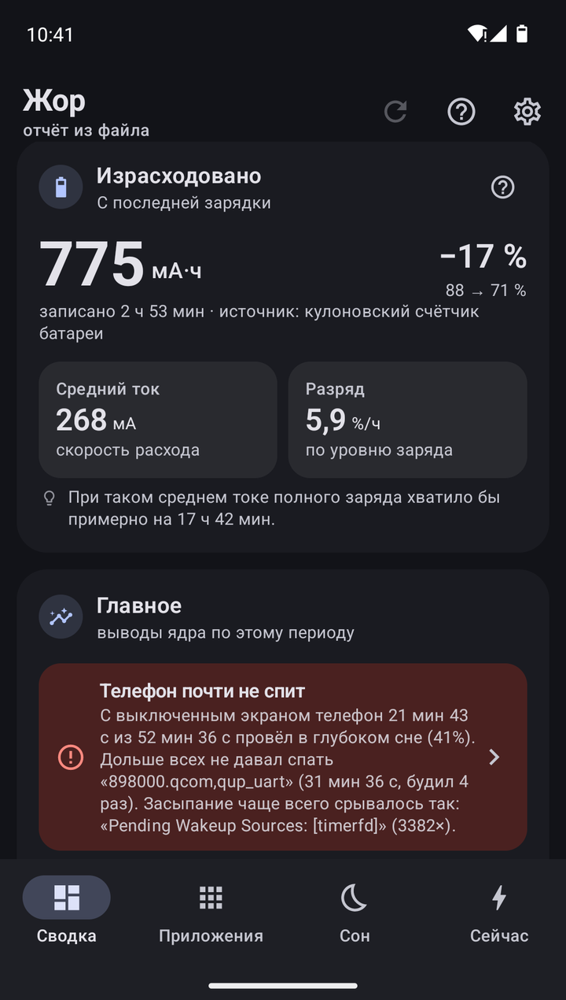
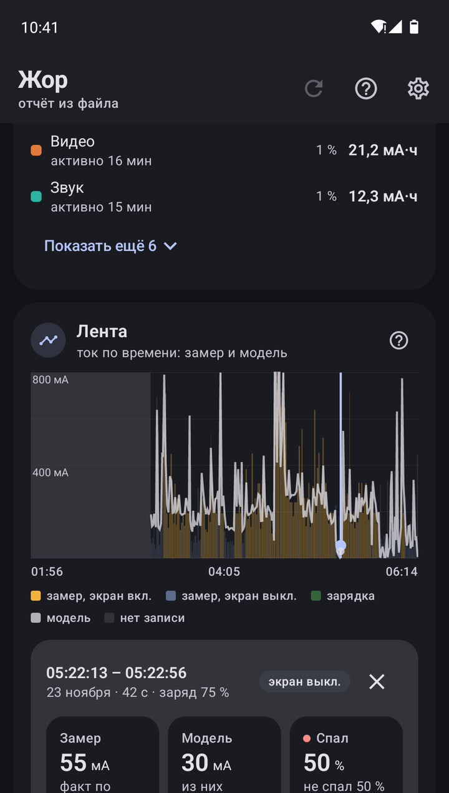
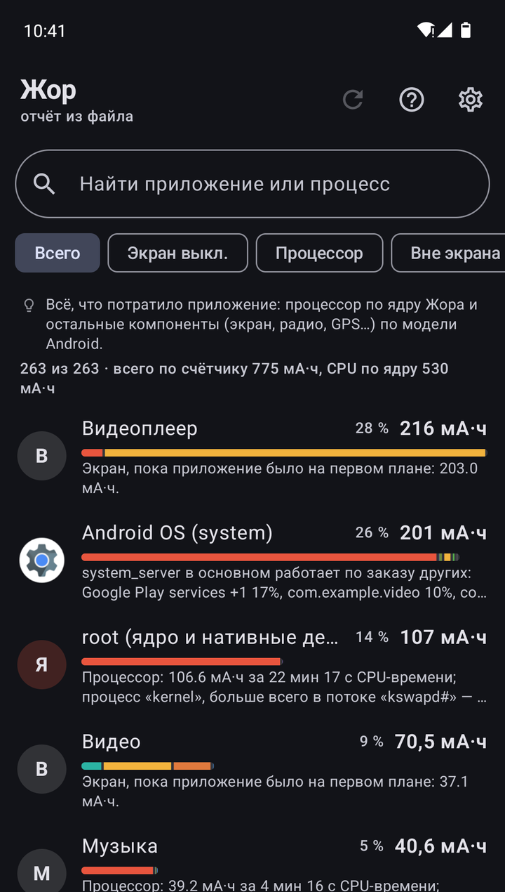
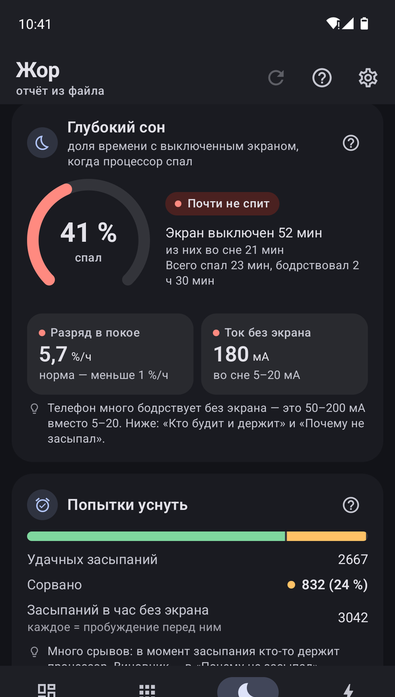
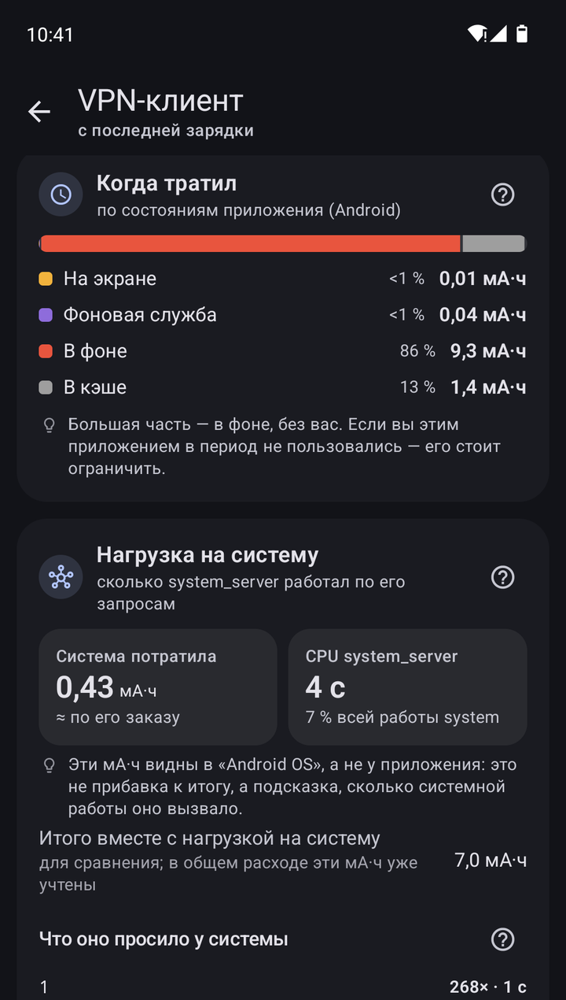
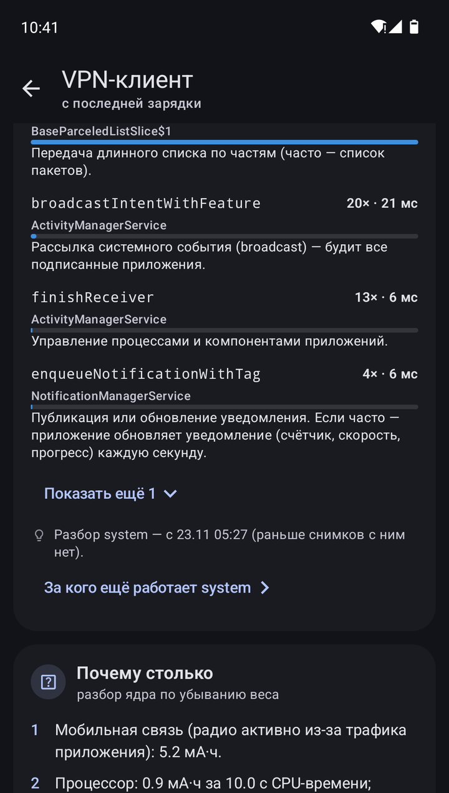
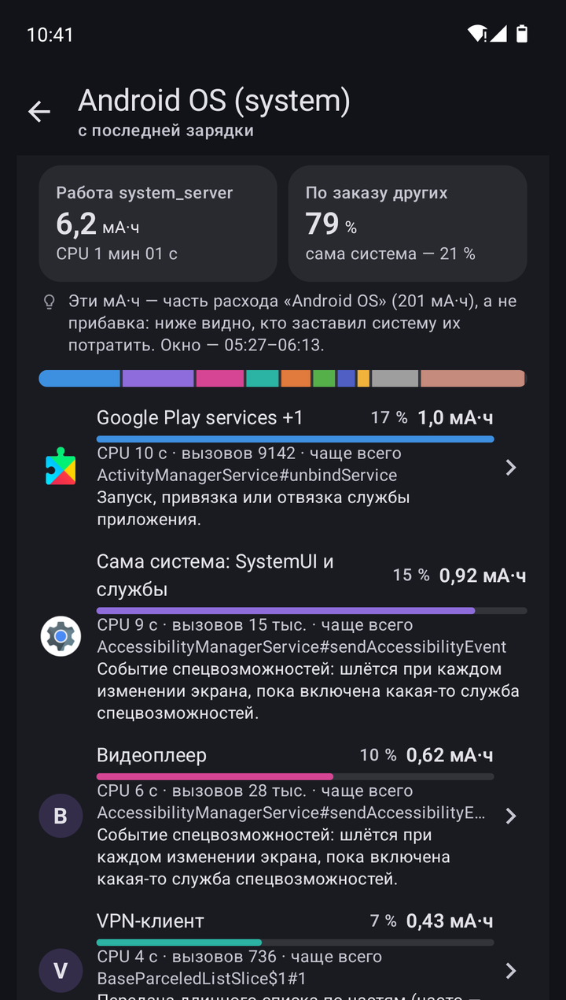
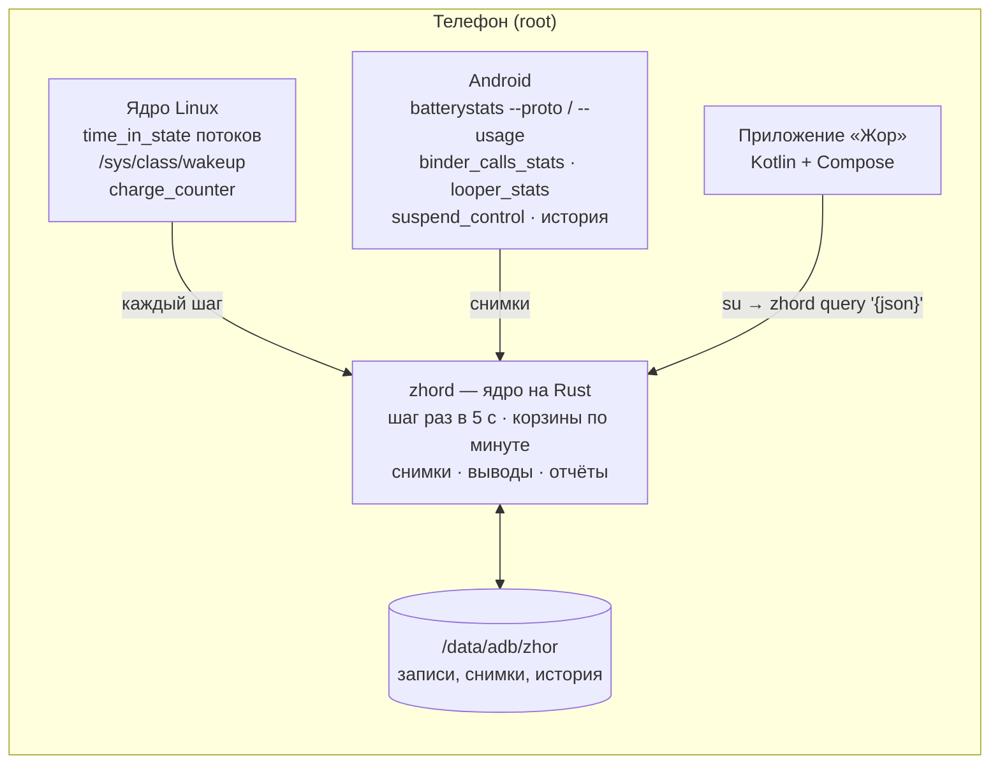

<div align="center">


# Жор

**Что жрёт батарею Android — с точностью до процесса, потока и причины.**

Root-профилировщик энергопотребления. Ядро на Rust меряет каждый поток на каждой частоте процессора,
сверяет модель с кулоновским счётчиком батареи и объясняет по-русски: кто, где, сколько и почему.

[](https://github.com/niazlv/zhor/releases/latest)
[](https://github.com/niazlv/zhor/actions/workflows/ci.yml)
[](LICENSE)


**[Скачать APK](https://github.com/niazlv/zhor/releases/latest/download/zhor.apk)** · [English](README.en.md) · [API ядра](docs/api.md) · [Как это работает](#как-это-работает) · [Изменения](CHANGELOG.md)

</div>

<table>
  <tr>
    <td align="center"><br><sub><b>Сводка</b> — факт, модель, выводы</sub></td>
    <td align="center"><br><sub><b>Лента</b> — тап по любой минуте</sub></td>
    <td align="center"><br><sub><b>Кто жрёт</b> — с разбивкой</sub></td>
    <td align="center"><br><sub><b>Сон</b> — кто будит и держит</sub></td>
  </tr>
  <tr>
    <td align="center"><br><sub><b>Приложение</b> — когда и на что</sub></td>
    <td align="center"><br><sub><b>Почему столько</b></sub></td>
    <td align="center"><br><sub><b>За кого работает system</b></sub></td>
    <td align="center" valign="middle"><sub>Скриншоты сняты на обезличенных<br>демо-данных: все сторонние<br>приложения заменены на<br><code>com.example.*</code></sub></td>
  </tr>
</table>

## Зачем

Встроенный экран батареи говорит «приложение X — 12 %» и на этом всё. Старые root-профилировщики —
BetterBatteryStats, Wakelock Detector, GSam Root Companion — умели больше, но на Android 12 и новее
перестали работать: `/proc/wakelocks` больше нет, `debugfs` закрыт, `/proc/uid_time_in_state` заменён
на eBPF, а внутренний формат `BatteryStatsImpl` меняется от версии к версии.

«Жор» собран заново на том, что в современных ядрах и Android есть и работает, и отвечает на четыре вопроса:

| | |
|---|---|
| **Кто** | приложение и его процессы — включая рендеры WebView и песочницы, отнесённые к приложению-хозяину |
| **Где** | конкретный поток: `RenderThread`, `binder`, `kworker/…-очередь`, `kswapd`, `HeapTaskDaemon` — с пояснением, что он делает |
| **Сколько** | мА·ч по модели (время потока на каждой частоте × ток ядра) и факт по кулоновскому счётчику батареи |
| **Почему** | wakelock, будильники, задания, синхронизации, GPS, радио, датчики, пробуждения ядра, сорванные засыпания и то, кто заставляет работать `system_server` |

## Возможности

- **Процессор до потока.** Ядро Linux ведёт для каждого потока время на каждой частоте каждого кластера
  (`/proc/<pid>/task/<tid>/time_in_state`). «Жор» умножает его на ток ядра на этой частоте из профиля
  мощности производителя и получает мА·ч каждого потока — без трассировки и без пропусков.
- **Факт против модели.** Сколько реально ушло из батареи (кулоновский счётчик) и сколько объясняет модель
  процессора и экрана. Остаток — радио, Wi-Fi, GPS, GPU, периферия — показывается честно, отдельной строкой.
- **Сон.** Доля глубокого сна при выключенном экране, удачные и сорванные засыпания, источники пробуждения
  ядра (`/sys/class/wakeup`), причины пробуждений и нативные wakelock служб и HAL с PID.
- **За кого работает system.** «Android OS» почти всегда работает по чьему-то заказу. По выборочной
  статистике Android (`binder_calls_stats`, `looper_stats`) видно, какое приложение сколько процессорного
  времени `system_server` потратило и каким вызовом — например, бесконечный опрос аккаунтов или уведомление,
  которое обновляется каждую секунду.
- **Выводы.** «Телефон почти не спит», «Нагружает систему: …», «Не хватает памяти», «Постоянно
  перезапускается» — с порогами «хорошо / так себе / плохо» и подсказкой, что делать.
- **Лента.** Ток по времени: замер и модель, экран, зарядка. Тап по любой минуте — кто тратил именно тогда;
  отрезок открывается полным отчётом.
- **История Android.** События batterystats (wakelock, задания, синхронизации, экран, doze) с точностью до
  миллисекунды — лента отдельного приложения.
- **Сторож.** Уведомление в момент проблемы, а не утром: телефон не спит, батарея тает в покое, кто-то будит
  тысячи раз в час, приложение работает в фоне, телефон греется в кармане. Пороги настраиваются, лишнее —
  «не напоминать». Проверка идёт на обычном шаге ядра и телефон не будит.
- **До и после.** Ограничить приложению фон или остановить его — прямо из карточки, а потом сравнить покой до
  и после: ток, разряд, сон, пробуждения, его процессор, будильники и wakelock. Или просто эту ночь с прошлой.
- **Сейчас.** Ток батареи в реальном времени и кто прямо сейчас тратит процессор.
- **Данные под рукой.** Сколько занято и сколько записей по дням; выгрузка отчёта в JSON, текст или сырые
  записи `.jsonl.gz` в два нажатия.

## Как это работает



- **Ядро `zhord`** — root-демон на Rust (`core/`). Раз в 5 с при включённом экране и раз в 20 с
  бодрствования при выключенном читает процессы, потоки, частоты, батарею, экран и источники пробуждения,
  складывает их в корзины по минуте и хранит 10 дней. Снимки статистики Android — раз в час, при смене
  экрана и зарядки и по запросу.
- **Приложение** (`android/`) — тонкий интерфейс: одна root-оболочка, запросы `zhord query '<json>'`,
  ответы JSON. Контракт описан в [`docs/api.md`](docs/api.md).
- **Модель:** энергия потока = Σ (время на частоте × ток ядра на этой частоте) из
  `dumpsys batterystats --power-profile`; экран — по яркости; факт — кулоновский счётчик батареи.

## Требования

- Android 12 или новее, arm64. Проверено на Xiaomi 15 Ultra (Android 17, ядро 6.6 GKI).
- Root: KernelSU или Magisk (нужен `su`; автозапуск — через `/data/adb/service.d`).
- Ядро с `CONFIG_CPU_FREQ_TIMES` (есть почти во всех ядрах Android) — для точного учёта по частотам.
  Без него «Жор» работает, но энергию потока оценивает по среднему току кластера, а не по частотам.

## Установка

1. Скачайте APK последней версии — [`zhor.apk`](https://github.com/niazlv/zhor/releases/latest/download/zhor.apk) (постоянная ссылка, всегда на свежий выпуск; удобна для
   обновлялок вроде Obtainium) или `zhor-*.apk` со страницы [последнего выпуска](https://github.com/niazlv/zhor/releases/latest), —
   и установите.
2. Откройте «Жор» и разрешите ему root в KernelSU или Magisk. Приложение само скопирует ядро в
   `/data/adb/zhor/bin/zhord` и запустит его; при обновлении ставит ядро, только если его сборка новее.
3. Автозапуск после перезагрузки включается в настройках приложения.
4. Дальше Жор обновляется сам: раз в сутки проверяет новую версию и присылает уведомление. Ставит — только по
   кнопке «Обновить»: скачивает APK с GitHub, сверяет контрольную сумму из `SHA256SUMS` и сертификат подписи
   с установленным Жором и ставит через root, без системного окна установки.

Каждый выпуск собирается в [GitHub Actions](https://github.com/niazlv/zhor/actions/workflows/release.yml)
из тега, рядом лежат `SHA256SUMS` и аттестация происхождения сборки. Сертификат подписи APK, SHA-256:

```text
D6:8C:8C:CD:B4:00:27:77:FF:2C:78:91:30:52:4C:05:9D:7B:2E:B4:F2:A6:1D:D5:A1:9D:10:79:EA:CF:46:1C
```

### Сборка из исходников

Нужно: [Rust](https://rustup.rs) с целью `aarch64-linux-android`, [`cargo-ndk`](https://github.com/bbqsrc/cargo-ndk),
Android SDK 36 с NDK 27, JDK 17–21.

```bash
rustup target add aarch64-linux-android
cargo install cargo-ndk
```

```bash
./build.sh            # тесты ядра, ядро под arm64, APK
```

```bash
./build.sh install    # то же + установка на подключённый телефон (adb)
```

NDK ищется в `ANDROID_NDK_HOME` (по умолчанию — путь Android Studio на macOS), JDK — в `JAVA_HOME`.
Если подключено несколько устройств, выберите нужное через `ANDROID_SERIAL`.

Своя сборка подписывается отладочным ключом и поверх выпуска с GitHub не встанет — сначала удалите
приложение (данные ядра в `/data/adb/zhor` останутся). Свой ключ можно указать в
`~/.android/zhor-release.properties` (`storeFile`, `storePassword`, `keyAlias`, `keyPassword`).

### Выпуск версии

Поднять версию в `core/Cargo.toml` и `android/app/build.gradle.kts` (`versionName` и `versionCode`),
добавить раздел в [`CHANGELOG.md`](CHANGELOG.md) и отправить тег — остальное сделает
[`release.yml`](.github/workflows/release.yml):

```bash
git tag v0.5.1 && git push origin v0.5.1
```

## Командная строка

Ядро работает и без приложения — например, по adb:

```bash
adb shell su -c '/data/adb/zhor/bin/zhord report'               # с отключения зарядки
adb shell su -c '/data/adb/zhor/bin/zhord report screen_off'    # последний период с выключенным экраном
adb shell su -c '/data/adb/zhor/bin/zhord report 24h --json'    # то же, что видит приложение
adb shell su -c '/data/adb/zhor/bin/zhord oneshot 10'           # без демона: кто тратит прямо сейчас
adb shell su -c '/data/adb/zhor/bin/zhord alerts'               # что заметил сторож
adb shell su -c '/data/adb/zhor/bin/zhord compare rest'         # два последних периода покоя
```

Пресеты: `since_unplug`, `screen_off`, `charge`, `1h` `3h` `6h` `12h` `24h` `48h`, `all`;
ещё `live`, `status`, `stop` и `query '<json>'` — см. [`docs/api.md`](docs/api.md).

## Сколько стоит сам «Жор»

Профилировщик, который сам сажает батарею, бесполезен, поэтому цена считается так же, как у всех, — процесс
`zhord` виден в отчёте, а в приложении есть карточка «Цена самого Жора».

- **Сну не мешает.** Ядро не берёт wakelock, не ставит будильники и таймеры пробуждения; шаги идут на
  монотонном таймере, который во сне стоит. Шаг делается, только когда телефон и так бодрствует.
- **Шаг ≈ 30 мс процессора.** Простаивающие процессы читаются раз в 6 шагов, потоки раскладываются раз
  в ~30 с на процесс — суммы точные, детализация с задержкой.
- **Около 2 мА при включённом экране** (~0,3–0,4 % расхода), в глубоком сне — ноль.
- **Снимок статистики Android ≈ 0,5 с процессора `system_server`** раз в час и при смене экрана или
  зарядки. Сводка берётся через `--proto` (~100 мс вместо ~450 мс у 13 МБ текста `-c`); полная история
  читается раз в 3 часа и при просмотре отчёта.

## Приватность

- **Интернет — только для обновлений.** Раз в сутки приложение спрашивает у GitHub номер последней версии
  (обычный запрос к `api.github.com`, о телефоне ничего не передаётся) и по вашей кнопке скачивает новую.
  Записи и отчёты никуда не отправляются: вся работа с сетью — в одном файле,
  [`Updater.kt`](android/app/src/main/java/dev/niazlv/zhor/Updater.kt). Проверку можно выключить в настройках,
  ядро `zhord` в сеть не ходит вовсе.
- Всё хранится в `/data/adb/zhor` и удаляется кнопкой в приложении.
- Ядро принимает запросы только от root (проверка `SO_PEERCRED`) и пишет выгрузки только в папку
  приложения и общие каталоги.

## Что Жор меняет в системе

Только то, что вы нажали сами, и всё возвращается:

- **«Остановить»** — разовое, как «Остановить» в настройках приложения: оно оживает, как только его откроют.
- **«Ограничить фон»** — стандартное ограничение Android (`RUN_ANY_IN_BACKGROUND`); снимается кнопкой в карточке,
  «Вернуть всё» на экране «Сторож» или в настройках батареи приложения. «Вернуть всё» ставит режим, который был до Жора,
  и не трогает то, что вы с тех пор поменяли сами. Без приложения — `zhord revert-all`.
- **Подробная история Android** — только если включить её в настройках; Android сам сбрасывает её при перезагрузке.
- **Удалили приложение** — ядро через 10 минут само вернёт ограничения, выключит подробную историю, уберёт свой
  автозапуск и остановится. Записи останутся в `/data/adb/zhor` — удалить их можно кнопкой в приложении до удаления
  или вручную.
- **Отнять root у приложения мало**: ядро уже работает от root и продолжит. Сначала «Вернуть всё» или удалите приложение.

## Устройство проекта

```text
core/                 ядро zhord на Rust
  src/procfs.rs       процессы и потоки, time_in_state, энергия
  src/sampler.rs      шаг сбора, корзины, события, снимки
  src/report.rs       отчёт: приложения, процессы, потоки, выводы, лента
  src/history.rs      история событий Android
  src/watch.rs        сторож: правила покоя, тревоги, доставка в приложение
  src/compare.rs      действия с приложением, «вернуть всё», сравнение «до/после»
  src/guard.rs        приложение удалили — вернуть ограничения, убрать автозапуск
  src/sys/            batterystats (proto, usage, checkin), suspend, binder/looper
  src/explain.rs      словарь «что это и почему» по-русски
android/              приложение на Kotlin + Jetpack Compose
docs/api.md           контракт ядро ↔ приложение
build.sh              сборка: ядро → jniLibs → APK
.github/workflows/    CI на каждый пуш, выпуск по тегу
```

## Ограничения

- Процессы, родившиеся и умершие между двумя шагами, видны только в статистике Android.
- GPU, модем, Wi-Fi и GPS не моделируются ядром — их доля приходит из модели Android и из «прочего»
  (факт минус модель процессора и экрана).
- Коэффициенты производителя бывают завышены или занижены: абсолютные мА·ч процессов тогда сдвигаются,
  доли между приложениями — нет. Сверка с кулоновским счётчиком показывает расхождение.
- Разбор «за кого работает system» — по выборке Android (каждый N-й вызов), это оценка.

## Лицензия

[MIT](LICENSE) © 2026 niazlv. Пул-реквесты и сообщения об ошибках приветствуются.
